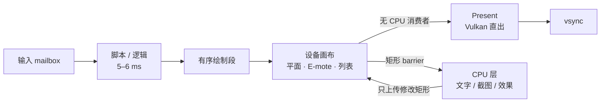

# 让安卓端流畅度接近 PC：目标、架构与实施计划

更新日期 2026-11-21。代码核对基于提交 `ff422db` 及当前工作区。稳态数字来自 `archive/2026-11/20261120_210512_976591_android_integration/20261120_android_candidate_story_156.log`（APK profile `android-integration`，画布 1280×720，NEKOPARA 双人场景，134 个含 E-mote 的帧）。

本文是执行计划，不重复三份既有文档的缺陷清单，只回答一个问题：**怎么把“能跑”变成“跟 PC 一样跟手、顺滑”。**

状态标记：

| 标记 | 含义 |
| --- | --- |
| 已测 | 真机日志或回放已归因到具体阶段 |
| 已确认 | 当前源码已证明存在该行为 |
| 估算 | 由已测数据推算，不是收益承诺 |
| 待验证 | 有代码风险或现场现象，尚未同版复现 |
| 目标 | 工程验收方向，达到前不能写成当前能力 |

## 0. 结论摘要

1. 现在不是“帧率低一点”，而是**每帧 90–100 ms、单线程串行、GPU 与 CPU 之间每帧往返两次以上**。PC 的感觉来自 16.7 ms 预算内做完所有工作，并且没有像素回读。
2. 提帧的第一优先级不是继续优化脚本/音频，而是**把画布所有权移到设备、把每帧回读压到一次（最好零次）**。这一步不做，其他优化都落在噪声里。
3. 第二优先级是**输入与帧解耦**。输入现在排在整帧之后，p50 37.6 ms、p95 108 ms；这跟帧率无关，但直接决定“跟不跟手”。
4. 第三是**节奏**。去掉固定 60 Hz catch-up，改成呈现驱动；否则低帧率时 CPU 全速空转、发热、帧间隔抖动，30 fps 也会显得“一顿一顿”。
5. 现实目标分两档：**先 30 fps 稳定 + 输入 p95 ≤ 100 ms**（普通对话场景可到 40–50 fps），再冲 **60 fps**。60 fps 需要文字/列表也进设备画布，是第二阶段。

### 0.1 帧预算

| 阶段 | 60 fps 预算 | 30 fps 预算 | 现状（已测 p50） |
| --- | ---: | ---: | ---: |
| 逻辑 / 脚本 | 4 ms | 6 ms | 5.9 ms |
| 平面合成 | 4 ms | 10 ms | 47.4 ms |
| E-mote | 4 ms | 10 ms | 30.8 ms |
| 文字 / UI | 1 ms | 3 ms | 0.002 ms（本样本） |
| 呈现 | 3 ms | 4 ms | 未测 |
| 余量 | 0.7 ms | 0.3 ms | — |

这张表是设计预算，不是当前能力。平面和 E-mote 两格是全部问题的所在：它们在 PC 上只是一批 GPU 绘制，在本仓库是“CPU 栅格 + 回读 + CPU 混合”。

### 0.2 最小可行改动（只有一周时）

1. 输入改用 `postAtFrontOfQueue`，先砍掉排队（0.5 天）。
2. 去掉 `MAX_CATCH_UP_MS` 的追赶逻辑，改为“错过的槽直接丢、对齐下一次 vsync”（0.5 天）。
3. 无 E-mote 的普通对话场景，把多次平面回读合并成一次（2–3 天）。
4. 用 `--profile perf` 构建同源 APK，做一次 -O1/-O3 对照（0.5 天）。

预期：普通对话帧从 39.5 ms 降到 25–30 ms，输入 p95 从 108 ms 降到 40 ms 以内。双人 E-mote 仍然到不了 30 fps，但“跟手”和“不一顿一顿”会先回来。

## 1. “接近 PC 的感觉”拆成五个可测指标

| 指标 | PC 参照 | 安卓现状 | 阶段目标 |
| --- | --- | --- | --- |
| 稳态帧率 | 60 fps / 16.7 ms | 10–11 fps / 90–100 ms | M1：30 fps；M3：60 fps |
| 帧间隔抖动（p95−p50） | < 4 ms | 未测（present 数据缺失） | ≤ 8 ms |
| >100 ms 长帧 | 0 | 每次点击、首次角色、音频启动 | 稳态 ≤ 1 次/分钟（加载除外） |
| 输入到呈现 p95 | 约 50 ms | 点击→提交 334 ms（旧样本） | 30 fps 下 ≤ 100 ms；60 fps 下 ≤ 70 ms |
| 30 分钟热稳定 | 不降频 | 单核打满、持续满载 | 无持续降频，帧率波动 ≤ 10% |

“PC 的感觉”不是单一帧率，而是**这五项同时成立**。只把 p50 从 90 ms 压到 50 ms，但输入还排在帧后、帧间隔还抖，体感仍然是“卡”。

表中的“PC 参照”是 60 Hz vsync 下的经验值，不是本仓库对原版的采样；只有“安卓现状”一列来自已归档日志。

## 2. 现状：90 ms 花在哪

### 2.1 E-mote 场景（134 帧，已测）

| 段 | p50 | p95 | 说明 |
| --- | ---: | ---: | --- |
| step | 77.2 ms | 93.7 ms | 一次 `nativeStep` 的总时长 |
| compose | 71.0 ms | 80.9 ms | `render_scene` 总时长 |
| compose_plane | 47.4 ms | 48.1 ms | 几乎恒定，说明是整块面积成本 |
| compose_emote | 30.8 ms | 32.5 ms | 姿态栅格 + 混合 |
| script | 5.9 ms | 9.4 ms | 本轮 KCS 优化的目标段 |

注意：以上是各自的中位数，**不能相加**（中位数之和 ≠ 和的中位数）。能确定的只有量级：平面和 E-mote 两项吃掉了 compose 的绝大部分，脚本只占 7.6%。

### 2.2 平面耗时 >5 ms 的 1153 帧（含少量 E-mote 帧，已测）

| 段 | p50 | p95 |
| --- | ---: | ---: |
| step | 39.5 ms | 78.7 ms |
| compose | 25.5 ms | 72.0 ms |
| compose_plane | 24.5 ms | 47.6 ms |
| script | 12.4 ms | 15.0 ms |

也就是说，**即使没有 E-mote 参与，平面合成也足以把一帧推到 25–40 ms**，对应 25–40 fps。这决定了优化顺序：先救平面，收益覆盖所有场景；E-mote 只影响角色场景。

### 2.3 往返与排队（已测）

| 项目 | p50 | p95 | 次数 |
| --- | ---: | ---: | ---: |
| packed 回读（含 GPU 完成等待） | 15.6 ms | 25.8 ms | 2565 次 / 2134 帧，约 1.2 次/帧 |
| device 回读 | 3.2 ms | 8.9 ms | 835 次，约 0.4 次/帧 |
| 触摸 UI→worker 排队 | 37.6 ms | 108 ms | 最大 209 ms |

packed 每次搬 3,686,416 B（3.52 MiB，正好一张 1280×720 RGBA）。平板上 3.5 MiB 要 15.6 ms，粗算约 0.23 GB/s；桌面同量级回读约 1.3 GB/s。**同一个“GPU 加速”策略，在平板上可能被回读吃掉**，这是 E1 在 Windows 有效、安卓没感觉的最可能机制（待同版 A/B 验证）。

### 2.4 一个待确认的异常

这份日志里 2134 条 `unchanged` 帧记录**全部没有提交**，其中 134 条含 E-mote。

- 若画面确实静止：就是每 tick 白算 77 ms 再丢掉，属于纯浪费。
- 若画面在动：就是 `FRAME_UNCHANGED` 判定漏提交，有效帧被丢。

两种都必须用 present 计数和截图对齐确认；这是 H2 没有闭环的部分，也直接影响“看到的帧率”和“算出来的帧率”是否一致。

## 3. 根因：三个架构选择，一个构建选择

### 3.1 CPU 权威画布（已确认）

`Canvas` 始终持有完整 CPU 像素，GPU 只是“加速器”：每个批次结束都要 `copy_buffer_to_buffer` + `map_async` + `poll(Wait)` 把像素还回 CPU（`gpu_raster.rs::draw_jobs`、`DeviceFrame::read_rgba`）。即使走 `direct` 设备帧路径，也要把整幅映射回来做 `set_verified_device_pixels`。

这保证了逐像素等价、截图、存档缩略图、CPU 转场都能工作，但代价是**每帧多次同步往返**。PC 原版没有这个“回程”。

### 3.2 GPU 批处理 + 批末同步（已确认）

`draw_plane_group` 只在 `pixels >= 128K` 时启用；`draw_list_group` 要求至少 2 层且合计 ≥192K。批次之间不能重叠，因为每个批次结束就同步读回。结果：GPU 的并行能力没有被用来隐藏 CPU 工作，反而增加了同步点。

### 3.3 单线程 + 固定节拍（已确认）

`PlayerEngineActivity.frame` 在同一个 `HandlerThread` 上串行执行 `nativeStep` → `nativePresent`；`presentFrame` 还持有 `surfaceLock` 并阻塞在 `eglSwapBuffers`/Vulkan present。输入 `worker.post` 排在同一队列尾部（`touch`）。

调度是固定 60 Hz + `MAX_CATCH_UP_MS = 66`：落后时 `nextFrame = max(planned, now - 66)`，会立刻连跑，形成“突发几帧 + 长空档”，而不是稳定间隔。

### 3.4 构建 -O1（已确认）

`[profile.android-integration]` 是 `opt-level = 1`、`lto = false`。逐像素循环在这个级别下通常比 -O3 慢 1.5–3×。这是全局乘数，不能用它冒充某项算法优化的收益，但也不能忽略。

### 3.5 PC 参照为什么顺

- 画布就是 backbuffer/纹理，合成即绘制，`Present` 一次，没有 CPU 回读。
- 资源在加载期解码成纹理并常驻，运行期没有整帧分配/解码。
- E-mote 走 `emotedriver.dll` 的原生 GPU mesh，不是逐像素 f64。
- 每帧 CPU 工作量远小于 16.7 ms，输入帧首采样，所以 60 Hz 不欠账。

以上是对原版的架构判断（PE 导入 + 恢复记录），不是对原版的采样；要拿它当定量基线，需要 PresentMon/ETW 或 GPUView 采一次。

## 4. 目标架构



四条规则：

1. **帧内设备画布权威。** 连续 GPU 段写同一张设备画布，不再逐批物化；只有声明的 CPU barrier 才读回。
2. **barrier 按矩形，不按整帧。** 文字只读回文本框，截图才读整帧；所有矩形合并成一次 `map` 等待。
3. **E-mote 在设备上合成。** 姿态纹理留在设备，用模板/混合直接画进设备画布；CPU 只做求值和命令准备。
4. **输入不进帧队列。** 触摸写入原生 mailbox，帧首统一消费；present 不持锁。

这套结构不要求“全 GPU 渲染图”，只要求“一段有序绘制 + 少量显式同步点”。现有的 `gpu_raster` 计算着色器、`gpu_emote` 的模板/混合、Vulkan 直出都能复用，缺的是**所有权和同步时机**。

## 5. 工作包

### W1 单 barrier：设备画布 + 矩形读回

**问题**：每帧 1.2 次 packed 回读，单次 15.6 ms；回读发生在批次之间，无法与后续工作重叠。

**做法**：

- 同一绘制段内的平面/列表/E-mote 连续写入设备画布，不再每批 `map`。
- 第一个真正需要 CPU 像素的消费者（文字、CPU 效果、截图、存档）才触发读回；读回矩形按重叠合并，避免“两个小矩形并成整帧”。
- 文字层优先做成“小矩形 barrier”：只读回文本框，CPU 混合后只上传该矩形。
- 纯 GPU 帧（无 CPU 消费者）不读回，直接呈现。

**代码入口**：`gpu_raster.rs::draw_jobs`、`DeviceFrame::read_rgba`、`Canvas::set_verified_device_pixels`、`plane_native.rs::draw_plane_group`、`lib.rs::render_scene` / `flush_plane_group`。

**验收**：`gpu_output packed_calls` ≤ 1/帧（目标 0）；典型对话帧 D2H ≤ 512 KiB；`compose_plane` ≤ 12 ms；逐像素对照一致；读回失败时按 G1 重放或明确报错，不得交付旧帧。

**回退**：新增开关 `debug.cs2.single_barrier=0`，回到逐批读回。

### W2 E-mote 设备合成

**问题**：`compose_emote` 30.8 ms。CPU f64 栅格只有 7.8 Mpx/s；现有 GPU 路径又把整姿态 RGBA 读回，再 CPU 混合，等于把省下的栅格时间还给回读。

**做法**：

- 姿态纹理留在设备；用现有模板/混合 pass 直接合成进设备画布，不下载整幅 RGBA。
- 过渡方案：CPU f64 扫描线算出姿态后上传到设备，在设备上混合；仍然避免 D2H。
- 只有需要像素校正时才读回 flags/alpha bbox；`flags == 0` 时跳过 repair，去掉 `pixels.to_vec()`。
- 双角色共享一次等待，但保持各自姿态与绘制顺序。

**代码入口**：`gpu_emote.rs::render`、`emote_native.rs::draw` / `submit_rgba`、`emote_cpu.rs::render_model`。

**验收**：`compose_emote` ≤ 10 ms；`emote_gpu readback_bytes` 降到 0（或仅 flags）；遮罩、换装、眨眼、口型、双人前后顺序逐像素通过；无 GPU 设备回退 CPU 时行为不变。

**回退**：`debug.cs2.emote_gpu=0` 回 CPU；新增 `debug.cs2.emote_device_blend=0` 回“GPU 栅格 + 回读 + CPU 混合”。

### W3 呈现与节奏

**问题**：present 成本未测；固定 60 Hz catch-up 在低帧率时制造突发；30 fps 内容在 60 Hz 屏上不按 vsync 对齐会抖。

**做法**：

- 确认后端：抓 `present=vulkan|egl_gles2|egl_fallback reason=`。优先 Vulkan 直出；EGL 回退只保留一条“整帧上传”路径，不再每帧重建 surface。
- Vulkan 输出按画布尺寸（1280×720）或硬件 overlay 呈现，避免在 2136×3200 上做全屏采样。
- 调度改为呈现驱动：一帧在途，`swap`/`Choreographer` 对齐 vsync；错过的槽直接丢，不追赶。
- 30 fps 内容固定“每两个 vsync 一帧”，不要用 `postAtTime(now+33)` 自由漂移。

**代码入口**：`PlayerEngineActivity.frame` / `scheduleFrame` / `presentFrame`、`bridge.c`、`egl_presenter.c`、`gpu_raster_present.rs::Presenter::render`。

**验收**：present p50 ≤ 4 ms、p95 ≤ 8 ms；帧间隔 p95−p50 ≤ 8 ms；连续 60 s 无“突发—空档”；旋转/切后台/重建 Surface 正常。

### W4 输入与帧解耦

**问题**：`touch` 把事件 post 到帧队列尾部，p50 37.6 ms、p95 108 ms 才进 native；present 持 `surfaceLock`。

**做法**：

- 短期：`worker.postAtFrontOfQueue`，先砍掉排队；present 不再持 `surfaceLock` 做长操作。
- 长期：新增全局输入 mailbox（`Mutex<VecDeque>` 或 SPSC 环），JNI `cs2_android_enqueue_input` 不触碰 `SESSIONS`（它是 thread-local）；帧首 `apply_pending_host_input` 统一消费。
- 连续点击合并；记录 `input_mono_us`、入队/出队、消费 tick、提交、present。
- 明确“输入按消费的逻辑 tick 记账”，不能用提交时间冒充。

**代码入口**：`PlayerEngineActivity.touch`、`android/src/lib.rs`、`portable_host.rs::apply_pending_host_input`。

**验收**：`ui_to_worker_us` p95 ≤ 16 ms（mailbox 后 ≤ 5 ms）；30 fps 下 input→photon p95 ≤ 100 ms；连点不丢、不重复触发。

### W5 资源与 hitch

**问题**：906 冷载 1.05 s、音频启动 756 ms、标题 4.3–7.1 s。这些不是稳态帧率，但用户感知为“卡死”。

**做法**：

- 906 拆成 read / inflate / parse / texture / import 五段计时；分层缓存（解析模型、纹理派生、实例状态）；后台只做 `Send + Sync` 的读取/解压/解析，发布仍在帧边界。
- 音频：同格式连续对白复用 voice lane；standby 预热按格式/路由能力决策；准备阶段按资源 singleflight，不持全局锁解码。
- 标题：按里程碑（native 初始化、资源索引、startup、首图、首字、首模型、首次呈现、可交互）找第一个超预算串行段。
- 图像解码移到后台，帧内只发布完整结果，不显示半张图。

**代码入口**：`emote_native.rs`（906）、`audio.rs` / `audio_android*.rs`、`resource.rs`、`message_backend.rs`。

**验收**：906 冷载 ≤ 400 ms、热切回 ≤ 50 ms；对白启动 p95 ≤ 150 ms；标题可交互 ≤ 2.5 s；稳态 >100 ms 长帧 ≤ 1 次/分钟。

### W6 文字与 FES 布局（按作品命中）

**问题**：FES 每次 `layout_atoms` 全量重排（`message_backend.rs`），列表整层重混合；旧标题样本 28.6 ms。NEKOPARA 的 CST 文本只有 2 µs，不是本样本瓶颈。

**做法**：

- 稳定前缀布局缓存：配置/宽度/字体/断行不变时只处理新增 atom；RawX/RawY、ruby、inline image、对齐变化时明确全量重排。
- 逐 glyph dirty 贯通到列表失效，身份变化才退回整层。
- 文字优先做“小矩形 barrier”或独立设备层，避免为一行字读回整帧。

**验收**：长正文逐字 append 的布局 atom 复用率 ≥ 90%；`click → 文字可见` p95 ≤ 120 ms；halo/透明邻域逐像素一致。

### W7 构建与编译

**问题**：`android-integration` 是 -O1；热循环的编译器乘数未量化。

**做法**：

- 新增/使用 `perf` profile（opt-level 3、thin LTO、无增量）构建同源 APK。
- 同场景、同存档、同设备交替 A/B；记录 APK 哈希、profile、温度。
- 先测 `cs2-renderer` / `cs2-runtime` / `cs2-desktop` 三个 crate 的敏感度，再决定是否全量 LTO。
- PGO 后置，训练集必须覆盖真实 E-mote/FES/脚本，不用合成循环代替。

**验收**：同源 -O1 vs -O3 的帧时间、输入延迟、二进制大小、冷启动各有数字；不以不同 profile 冒充算法收益。

### W8 观测与回归

**问题**：present 耗时、barrier 原因、D2H/H2D 字节、input→photon 都没有稳定输出；`f` CSV 在该日志里只有表头。

**做法**：

- 帧级汇总：`step/compose/script/plane/emote/text/present`，`barrier_reason`、`d2h_bytes`、`h2d_bytes`、`in_flight`。
- 输入链路：UI 采样、入队、出队、消费 tick、提交、present。
- 每次 barrier 记录原因和字节，按批次编号，避免“6 次读回”变成玄学。
- 固定 30 分钟长跑：线程数、RSS、显存、温度、帧率波动。

**验收**：任一长帧都能从日志还原到具体阶段和字节；显示 FPS 与 SurfaceFlinger/FrameTimestamps 对齐。

## 6. 里程碑

| 里程碑 | 内容 | 依赖 | 出口标准 |
| --- | --- | --- | --- |
| M0 基线 | 同版 APK、60 s trace、补齐 present/barrier 计数 | W8 | 任一帧可归因；-O1/-O3 基线各一份 |
| M1 30 fps | W1 + W2 + W3 基础 | M0 | 双人 E-mote step ≤ 28 ms；普通对话 ≥ 40 fps；帧间隔抖动 ≤ 8 ms |
| M2 跟手 | W4 + W3 节奏 | M1 | input→photon p95 ≤ 100 ms；连点不丢 |
| M3 60 fps | W6 + 文字设备层 + W7 | M2 | 普通对话/标题 60 fps；双人 E-mote 30 fps 稳定 |
| M4 稳定 | W5 + 热/长跑 | M3 | 30 分钟无持续降频；稳态长帧 ≤ 1 次/分钟 |

顺序不能反：M1 之前做 W4，只会让“更快地排在长帧后面”；M3 之前做 W6，收益会被整帧回读吃掉。

## 7. 测量协议

### 7.1 同版 A/B

- 同一源码、同一 APK、同一存档、同一场景、同一设备、同一温度窗口。
- 开关放在运行时（`debug.cs2.*` / `CS2_*`），同二进制交替，避免“两个包”引入变量。
- 至少 3 轮 ABBA；报 p50/p95/p99，不报单次最好值。

### 7.2 必采字段

| 类别 | 字段 |
| --- | --- |
| 版本 | 提交哈希、APK SHA-256、profile、GPU 后端、开关值 |
| 设备 | 型号、系统、驱动、刷新率、分辨率、温度、电源 |
| 帧 | `step_us`、`compose_us`、`compose_plane_us`、`compose_emote_us`、`script_us`、`present_us`、`interval_us` |
| 传输 | `packed_calls/bytes`、`device_calls/bytes`、`h2d_bytes`、barrier 原因 |
| 输入 | UI 采样、`ui_to_worker_us`、消费 tick、提交、present |
| 资源 | 906 五段、音频启动、缓存命中/驱逐、RSS/显存 |
| 呈现 | `eglGetFrameTimestamps` 或 SurfaceFlinger `--latency`、显示 FPS |

### 7.3 命令

```bash
adb shell setprop debug.cs2.emote_gpu 0
adb shell setprop debug.cs2.plane_cpu_blend 0
adb logcat -s CS2Perf CS2Player CS2Audio
adb shell dumpsys SurfaceFlinger --latency
adb shell dumpsys thermalservice
python -B -X utf8 scripts/build/android_workspace.py build --integration --profile perf
python scripts/analysis/android_phase_metrics.py <log>
python scripts/analysis/android_flip_metrics.py <log>
python scripts/analysis/android_surface_metrics.py <log>
```

### 7.4 判定

- 只有 p95 改善且逐像素对照通过，才算收益。
- 帧率提高但输入 p95 变差，不算“更流畅”。
- 不同构建、不同设备的数字不能相加，也不能互相换算。

## 8. 不做什么

- 不跳逻辑 tick、不降分辨率、不冻结角色画面、不伪造呈现回执。
- 不为 GPU 覆盖率放宽覆盖/采样/混合契约（G2）；容差必须单独审查并附图像证据。
- 不把整个启动过程塞进一个后台线程后仍然串行。
- 不用“静止 60 Hz”冒充内容 60 fps；无新提交 ≠ 显示器停止刷新。
- 不用不同 profile 的数字冒充某项源码优化。
- 不为统一架构强上完整 GPU 网格；W2 的混合路径达到预算就停。

## 9. 风险与回退

| 风险 | 处理 |
| --- | --- |
| 读回失败/超时后交出旧像素（G1） | 失败即标记，重放或明确报错；不持久化旧帧 |
| 设备画布被后续 CPU 层破坏 | 三态机 + 内容版本；CPU 修改前物化，修改后只上传脏矩形 |
| Mali/Adreno 对 compute/stencil 支持差异 | 按设备能力选择后端；保留 CPU 混合回退 |
| 显存/内存上涨 | 设备画布 + 姿态纹理 + 图集按字节预算；LRU + 设备丢失可重建 |
| 60 fps 热降频 | 30 fps 作为稳定目标；60 fps 按设备能力分档 |
| 输入 mailbox 与 `SESSIONS` 线程模型冲突 | `SESSIONS` 是 thread-local，mailbox 必须独立于会话；JNI 入队不触碰 player |

## 10. 证据边界与待补

- 本文稳态数字来自 11-20 的 APK（E1 之前）；**E1 合入后的真机 A/B 不存在**，所以“本轮效果不明显”目前只有体感。
- present 后端与逐帧 present 耗时未知；该日志没有 `present=` 行，`f` CSV 只有表头。
- `unchanged` 异常未闭环：日志里 2134 条 `unchanged` 记录全部没有提交，需用 present 计数确认是“真静止”还是“漏提交”。
- 原版未采样；PC 参照是架构判断，不是定量基线。
- 待补：本轮 APK 哈希/profile、`debug.cs2.emote_gpu`/`plane_cpu_blend` 实际值、`draw=emote backend=`、`emote_gpu readback_us`、SurfaceFlinger latency、Perfetto 10 s、simpleperf 采样。

## 11. 代码与日志索引

| 范围 | 入口 |
| --- | --- |
| 设备画布 / 读回 | `simulator/crates/desktop/src/gpu_raster.rs`（`draw_jobs`、`DeviceFrame::read_rgba`） |
| 呈现 | `gpu_raster_present.rs`（`Presenter::render`）、`simulator/android/app/src/main/cpp/egl_presenter.c`、`bridge.c` |
| 平面 | `plane_native.rs`（`draw_plane_group`、`sampled_plane`） |
| E-mote | `gpu_emote.rs`（`render`）、`emote_native.rs`（`draw`、`submit_rgba`）、`emote_cpu.rs`（`render_model`） |
| 合成总入口 | `simulator/crates/desktop/src/lib.rs`（`render_scene`、`flush_plane_group`） |
| 画布 | `simulator/crates/renderer/src/lib.rs`（`Canvas`、设备态） |
| 帧循环 | `PlayerEngineActivity.java`（`frame`、`scheduleFrame`、`presentFrame`、`touch`） |
| JNI / 会话 | `simulator/crates/android/src/lib.rs` |
| 文字布局 | `simulator/crates/desktop/src/message_backend.rs`（`layout_atoms`） |
| 观测 | `perf_detail.rs`、`android_phase_metrics.py`、`android_flip_metrics.py`、`android_surface_metrics.py` |
