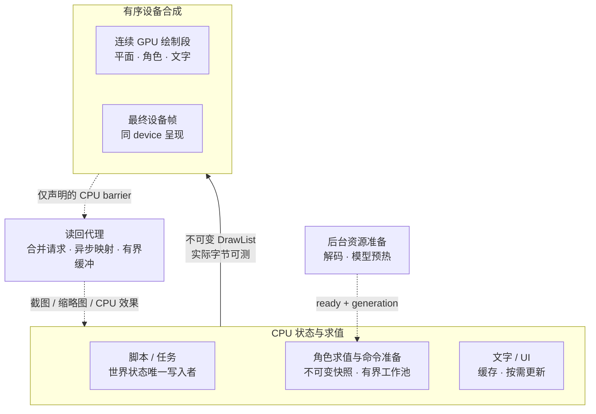
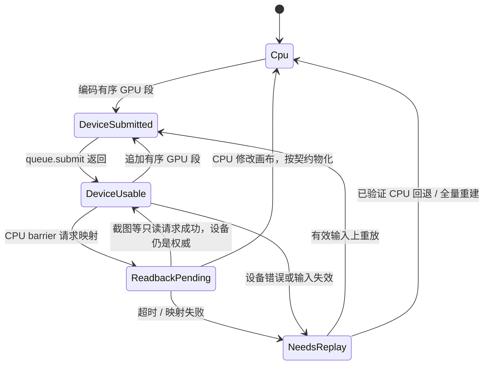

# CPU 与 GPU 协同的帧合成、动画与界面运算拆分方案

更新日期 2026-11-21。代码核对基于提交 `71e8a7681cafd0cefce9c57836ec46df0de5df6c` 及当前工作区；性能数字来自 [`2026-11-20-performance-optimization.md`](2026-11-20-performance-optimization.md) 及其引用的回放。本文只给设计、估算和决策门槛，本次修订未修改引擎代码。

状态标记：

| 标记 | 含义 |
| --- | --- |
| 已测 | 回放或真机日志已归因到具体调用或阶段；只适用于对应构建 |
| 已确认 | 当前代码路径已证明存在该行为或缺陷 |
| 估算 | 由已测数据推算，不是收益承诺 |
| 待验证 | 有代码风险或现场现象，尚未在同一构建中复现 |
| 目标 | 工程验收方向，达到前不能写成当前能力 |

## 0. 结论摘要

不建议把帧合成、动画和界面拆成三条独立计算流程。脚本改世界状态 → 求值产生绘制输入 → 按序合成 → 呈现，本质仍是一条依赖链。需要改变的是**画布所有权、逐像素工作的执行位置和同步时机**，而不是增加进程或消息会合点。

推荐按以下顺序推进：

1. **先消同步和分配，再迁更多绘制。** 合并连续 GPU 合成段，复用读回及输出缓冲；纯 GPU 帧不为呈现读回像素。桌面要直采设备帧，先统一光栅与窗口的 device/queue。
2. **E-mote 采用两级路线。** 过渡版保留已验证的 CPU f64 覆盖计算和 GPU 着色，只回读稀疏校正标记，将修正像素写回设备姿态；完整网格光栅作为后续可回退选项，而不是前置条件。
3. **缓存按命中证据启用。** 先做整帧不变跳过，再评估静态前缀和保留层。动画场景不预设保留层一定更快，移动端必须计入离屏纹理的存储、回读和功耗。
4. **跨帧流水是可选实验，不是基础依赖。** 必须有在途帧上限、资源生命周期和输入到实际呈现测量；不做通用脚本投机 run-ahead。
5. **每阶段用同二进制开关交替 A/B。** 保留已验证回退，按实际呈现间隔、P95/P99 和输入延迟决定是否保留优化。

正常纯 GPU 稳态的可量化目标是：最终帧 D2H 读回为 0、桌面整帧 H2D 上传为 0；动态顶点、命令和新资源上传仍按实际字节统计。原文的 Windows 18–26 ms、平板 35–45 ms 累计预测混合了不同构建，且把包含 GPU 工作的读回计时当成可全部消除的开销，本版不再把它作为预期结果。

平台优先级不必相同：Windows 先处理平面合成段、设备呈现和命令准备；Android 的 E-mote 约 141 ms 合成更靠前，不应等待所有保留层工作完成。

## 1. 现状与证据边界

### 1.1 当前主线帧链路

一帧的路径是：逻辑 tick（KCS 脚本、任务、控制器）→ `render_scene` 按深度顺序合成 → 平台呈现。GPU 目前以批处理算子参与，若后续操作需要 CPU 画布，批次之间必须物化像素。

| 环节 | 代码入口 | 当前行为 |
| --- | --- | --- |
| 场景合成总入口 | `simulator/crates/desktop/src/lib.rs:8103` | CPU 画布，`HostPhase::Compose` 分段计时 |
| 前缀层合成与脏区 | `simulator/crates/desktop/src/scene_compositor.rs:70` | 128×64 瓦片；层身份目前含像素指针判等，命中条件不满足时整幅拷贝 |
| 平面合批 | `simulator/crates/desktop/src/plane_native.rs:2324` | 无纹理三角形走 GPU；带纹理变换平面先进入 `sampled_plane` |
| 带纹理平面回退 | `simulator/crates/desktop/src/plane_native.rs:2393` | CPU 栅格出整画布尺寸透明中间图，再作为源交给 GPU；实际读回可只覆盖目标区域 |
| GPU 栅格算子 | `simulator/crates/desktop/src/gpu_raster.rs:839` | 计算着色器；重叠区域保持 dispatch 顺序，批末仍有同步映射路径 |
| 设备帧读回 | `simulator/crates/desktop/src/gpu_raster.rs:515` | `map_async` + `poll(Wait)`，250 ms 超时；`DeviceFrame` 每次申请读回缓冲 |
| 画布设备态 | `simulator/crates/renderer/src/lib.rs:1189` | `Device` 同时保留完整 CPU 像素和设备源；`set_device_pixels` 当前会同步取得完整像素，失败返回错误 |
| E-mote 渲染 | `simulator/crates/desktop/src/emote_native.rs:1141` | 主线 CPU 出姿态 RGBA，再逐行混合进画布 |
| E-mote 光栅 | `simulator/crates/runtime/src/emote_cpu.rs:1885` | CPU 逐三角形，f64 覆盖/插值和双线性采样 |
| Android 呈现 | `simulator/crates/desktop/src/gpu_raster_present.rs:247` | 已能直接消费同 device 的 `frame_on_device` |
| 桌面呈现 | `simulator/crates/desktop/src/lib.rs:9115` | 窗口持有自己的 device/queue，每帧 `write_texture` 整幅上传后画全屏三角形 |
| 行并行 | `simulator/crates/renderer/src/raster.rs:164` | 每次调用 `thread::scope` 创建至多 3 个附加线程，调用线程共同参与 |

主线的 E-mote 仍是 CPU 路径。性能 worktree 的候选已经实现 CPU 扫描线准备、GPU 着色/模板/混合和稀疏像素校正；三类实现不能共用一套“现状”数字。

### 1.2 实测数据按构建分开

固定场景为《NEKOPARA Vol.3》厨房 `01/32/475`，逻辑画布 2560×1440，双角色。2560×1440 RGBA8 一整帧为 **14.0625 MiB**。

| 构建与来源 | 指标 | 数值与可得结论 |
| --- | --- | --- |
| Windows 合并候选，80 帧 | 宿主主调用 | P50/P95 74.919/98.535 ms |
| 同一合并候选 | E-mote 合成、平面合成 | P50 分别 44.312、14.295 ms；合计后剩余约 16.312 ms，仍需细分，不能再写成“剩余约 42 ms” |
| 同一合并候选 | 6 次 packed 回读 | P50/P95 13.649/16.558 ms，18.20 MiB/帧；计时含 GPU 完成等待、映射和复制 |
| 同一合并候选 | E-mote 求值、准备、编码、读回、校正 | P50 分别约 11.130、12.779、1.899、4.299、6.575 ms；存在包含关系，不能全部相加 |
| Windows 稀疏校正 B4，另一构建 | 宿主主调用、6 次回读 | P50 81.556、21.961 ms；不能与前一组净时长相减 |
| 同一 B4 | 求值 + 命令准备 | P50/P95 18.708/21.420 ms；其中求值约 8.735 ms、准备约 9.880 ms |
| 两组 Windows 候选 | 平面中间图缓存 | 每帧 4 次 miss、0 hit；只说明该中间图键未复用，不能推出保留层缓存也会 0 hit |
| 线程对照候选 | 1/2/4 命令准备线程 | 准备 P50 30.028/17.255/11.426 ms；宿主主调用 P50 103.363/94.339/89.915 ms |
| 平板旧版 | E-mote 合成、整帧、CPU 更新 | 中位约 141、167、13 ms；不是上述 Windows 候选的真机结果 |
| 另一份平板旧版采样 | 实际帧间隔 | 约 125 ms；与 167 ms 整帧计时不是同一口径，不能据此计算优化后 FPS |
| 现有文字计时 | 直接文字合成、一次 FES 初始化 | 最大约 11 µs、一次约 15.6 ms；FES 完整路径仍未覆盖 |

线程对照中，四线程相对双线程的准备 P50 少 5.829 ms，宿主主调用只少 4.424 ms。这是该候选内部的实测对照，不能把 5.829 ms 再机械地从合并候选的 74.919 ms 中扣除。

### 1.3 像素搬运必须按介质和路径记账

下表是**单份有效像素载荷**，不是总线实际读写量；CPU 拷贝通常还同时产生读和写。条件项也不能全部当成每帧固定发生。

| 项目 | 单份/实测载荷 | 介质与触发条件 |
| --- | ---: | --- |
| `Canvas::clear` | 至多 14.06 MiB | CPU 内存写；只有未走可复用前缀等路径时发生 |
| 前缀整幅拷贝 | 至多 14.06 MiB | CPU→CPU；前缀变化、目标被后续层修改或身份未命中时发生 |
| 桌面 `write_texture` | 14.06 MiB | CPU→GPU；Windows wgpu 窗口路径，后台回放不当然包含此操作 |
| 合并候选回读 | 实测 18.20 MiB/帧 | GPU→CPU；约 14.06 MiB 平面、4.01 MiB 姿态、0.125 MiB 校正标志 |
| 顶点、扫描线命令和纹理上传 | 待逐帧统计 | CPU→GPU；即使最终帧零读回也仍可能存在 |

因此，原来的“46–60 MiB/帧 CPU↔GPU 带宽税”应改为“跨路径像素搬运清单”。不能将 CPU clear/copy 计入 CPU↔GPU，也不能把窗口上传与没有窗口呈现的后台回放直接相加。后续分别记录 `H2D texture`、`H2D commands`、`D2H final/pose/flags` 和 `CPU copy` 四组计数。

## 2. 对原始拆分设想的判断

**依赖链不能靠三个独立线程消除。** 合成必须消费对应世界状态的求值结果；重叠“第 N 帧合成”和“第 N+1 帧求值”改善的是吞吐，不自动改善输入到画面的延迟。流水后的吞吐接近最慢阶段，单帧延迟仍包含各阶段和排队时间。

**跨边界数据不一定是 KB。** 完整网格的变换清单可以很小，但现有混合候选每帧约 17.6 万条扫描线，命令缓冲是 MiB 级。跨线程只传不可变描述是正确方向，但必须记录实际命令、顶点和资源字节，不能先验宣称全部只有 KB。

**瓶颈不是简单的 CPU 线程不足。** 平板旧版主要是 E-mote 合成，Windows 候选有多次同步读回和大量扫描线准备。增加流水线不会自动消除这些工作。

**现有证据不支持独立 UI 流水线。** 直接文字合成很便宜，长尾更像初始化问题；但 FES 图像列表路径仍未完整量化，不能把“UI 全部无成本”写成结论。

结论是：先做有序 GPU 合成段和同步代理，再按实测迁移热点。专用提交线程、跨帧重叠和保留层均为后续选项。

## 3. 不可破坏的契约与拆分边界

### 3.1 四条边界

1. **状态边界**：脚本/VM 是世界状态的唯一写入者。并行求值读取带帧号的不可变快照，不回写世界，不提前执行声音、存档、随机数或其他副作用。
2. **求值→绘制边界**：传递不可变绘制描述、资源句柄和内容版本。描述可以是清单，也可以是所有权明确的 CPU/GPU 缓冲；实际大小进入测量。
3. **合成边界**：有序绘制段保持原始遮罩、裁剪和混合顺序。只有声明的 CPU barrier 可以请求像素；截图不应无条件把画布永久切回 CPU。
4. **资源边界**：后台线程优先只解码。纹理创建和上传由明确的 queue 所有者执行，在逻辑帧边界原子发布；旧资源由在途 DrawList/提交持有，不能仅靠 generation 提前释放。

资源尚未就绪时，按原有脚本语义等待、回退或报错，不能借异步发布悄悄显示上一版角色或纹理。

### 3.2 模块归属

| 模块 | 可否并行 | 边界条件与建议归属 |
| --- | --- | --- |
| KCS 脚本 / 任务调度 | 不做通用投机并行 | 世界状态和副作用保持原时序，CPU 主线程 |
| E-mote 控制器与时间线求值 | 条件并行 | 先证明角色间无共享可变状态；片内保序，CPU |
| E-mote 扫描线 / 命令准备 | 已有多线程候选 | 按有序部件分片、按原顺序合并；CPU 常驻工作池 |
| E-mote 着色、模板、混合 | 可外移 | 混合候选先保留 CPU 覆盖校正；GPU |
| E-mote 完整网格光栅 | 可选外移 | 覆盖、采样、透明边缘和遮罩通过契约后启用；GPU |
| 平面 / 图像合成 | 编码可分片，提交保序 | 重叠绘制不并行改变顺序；单 queue |
| 文字排版 / 字形栅格 | 技术上可并行 | 当前收益证据不足，保留 CPU 缓存，先补 FES 测量 |
| 资源解码 | 真异步 | 后台线程；发布不改变资源可见时序 |
| 音频 / 视频 | 已有独立路径 | 另按性能文档处理，不纳入本帧图重写 |

“每像素归 GPU、每状态归 CPU”只适合作为热点迁移方向，不是绝对规则。极小的 CPU 修补、兼容回退和已证明无收益的 UI 路径不应为了架构纯度而迁移。

## 4. 目标架构

### 4.1 三条逻辑车道，而非三个新线程

第一版可以继续由现有宿主线程编码和提交，避免为了“三车道”再引入线程跳转。只有测量证明提交排队成为瓶颈后，才考虑专用渲染线程。

### 4.2 画布所有权与完成状态分开

原文的 `DeviceDirty/DeviceClean` 同时混合了“内容是否变化”和“GPU 是否完成”，且读回失败后直接回到 `DeviceClean` 缺少恢复状态。建议把内容版本单独记账，画布只表达存储和同步：

`DeviceUsable` 只表示句柄可继续编码或呈现，不表示像素已完成映射。提交序号、映射请求号、帧号和资源 generation 必须一起携带。

读回代理遵守以下规则：

- 纯 GPU 呈现不读回；每个真正的 CPU barrier 尽量一次等待、一次合并拷贝。**不设置所有场景都必须 ≤1 次/帧的硬限制**：帧中 CPU 效果后再截图，可能天然需要两个同步点，应按原因记录并分别优化。
- 截图、存档缩略图优先异步完成，不阻塞无依赖的后续 GPU 工作；同一逻辑帧就必须消费的 CPU 效果仍需同步等待。
- 不盲目取所有矩形的几何并集。相距很远的两个小矩形可能因此变成整帧；应按重叠/间距合并，比较大矩形与多个 packed 小矩形后的实际字节，并处理 256 字节行对齐。
- 读回缓冲采用有界池。超时后迟到的 map 回调仍持有原缓冲，结果按请求号丢弃，不能复用给另一帧或污染新结果。
- CPU 只修改局部时，优先把修正重新上传并保留设备画布，而不是整帧回到 CPU。

### 4.3 失败恢复按失败类型处理

| 失败 | 正确处理 |
| --- | --- |
| 映射超时或回调失败，设备仍有效 | 请求标记失败；保留迟到回调所需资源。从仍有效的输入检查点有界重放一次，或走已验证 CPU 路径；不交付旧帧充当新结果 |
| 验证错误、单个算子不支持或预算超限 | 记录具体原因，仅回退该算子/分段；不能笼统当成超时，也不能无限重试 |
| Device lost | 所有设备纹理、seed、缓存和句柄均视为失效；重建 device/queue 后从 CPU 世界状态、原始资源和有序描述全量重绘 |
| Surface lost/outdated | 重建 surface，并重绘最近一次完整场景；不推进额外逻辑 tick，不伪造呈现回执 |
| 截图或缩略图读回失败 | 向调用者返回明确失败；不得把上一张截图持久化为本次结果 |

`CompletedPlanes` 的 before/seed 可用于设备仍存活时的局部重放，但 GPU seed 不能承担 device lost 后的恢复。长期恢复权威必须是可重建的 CPU 场景状态及资源身份，而不是另一份长期整帧 RGBA。检查点也必须有数量和字节上限。

### 4.4 最小设备帧图与呈现

不引入通用 DAG 渲染图。第一版只需要：

- 有序绘制段、离屏姿态/前缀纹理、最终设备帧和可选 CPU barrier；
- 无 CPU barrier 时，把多个 pass 尽量编入同一次 `queue.submit`；有同步需求时允许额外提交，不为“一次提交”破坏语义；
- Android 复用现有 `frame_on_device`；
- Windows 先让光栅与窗口共用 adapter/device/queue，再直接消费设备缓冲或设备纹理。不同 device 之间不能假设可零拷贝采样；
- 保留现有 storage-buffer 呈现作为最小迁移路径。是否全面改成 render pipeline/color attachment，由像素契约和实测决定。

## 5. 各类绘制的优化路线

### 5.1 平面：直接栅格，取消整画布中间图

`sampled_plane` 当前为变换平面生成整画布透明 RGBA，缓存键又随顶点变化，动画中命中差。目标是将源纹理、顶点、UV、裁剪、颜色和混合直接交给 `Draw::PlaneTriangles` 或等价设备路径。

先冻结 G2 的完整契约，而不仅是“最近邻差一列”：像素中心、top-left 覆盖、透视插值、f64→f32 转换时机、纹理边界、双线性取整、straight/premultiplied alpha、混合舍入和裁剪都必须明确。暂不兼容的几何继续走现有 CPU 路径；不得为了 GPU 覆盖率自行放宽像素要求。

连续平面可以合批，但重叠区域仍按原顺序 dispatch。第一批优化只取消中间图和多余物化，不同时引入保留层，便于归因。

### 5.2 E-mote：先混合设备姿态，再决定完整迁移

**路线 A：混合兼容路径，优先落地。**

1. 复用候选中已验证的 CPU f64 扫描线覆盖、GPU 采样/模板/混合；已有 18 个真实姿态逐像素等于 CPU 参考的记录。
2. 姿态保留在设备纹理/缓冲，不再默认下载完整 RGBA。只读回校正 bitset；CPU 用原 f64 路径重算命中像素，再将 `(x, y, RGBA)` 或 packed 修正块上传，在下一个消费者前应用。
3. 两个角色求值和资源确实独立时，把两次姿态生成放入同一提交，并共享一次校正标志等待。校正仍分别属于各自姿态，最终场景顺序不变。
4. 128 KiB 级标志先直接测量；只有扫描或传输仍占显著成本时，再增加 GPU 压缩坐标列表及密集回退。
5. 普通 SourceOver 优先消费裁剪后的设备姿态；只有依赖完整视口的操作才物化完整画布，消除候选 `expand_frame` 的整幅分配和复制。
6. 若后续存在真正的 CPU 全帧消费者，仍可按需完整读回；这是显式 barrier，不是每帧默认路径。

这条路线仍有 CPU 扫描线和校正等待，但改动小、兼容证据已有，能先去掉逐角色完整姿态 D2H 和后续 CPU 整幅混合。

**路线 B：完整 GPU 网格，按门禁启用。**

CPU 保留变量、时间线和必要顶点求值，GPU 执行覆盖、采样、遮罩和颜色混合。需要分别原型验证 hardware render pipeline 与有序 compute：前者通常更适合移动 GPU 的模板和混合，后者更容易复刻现有整数混合，但重叠绘制可能需要更多串行 dispatch。不能只按桌面结果选择。

若完整路径无法满足逐像素契约，保留路线 A；若路线 A 已达到帧预算，也没有必要为架构统一继续承担路线 B 的复杂度和显存开销。稀疏校正路径本身也是可长期保留的兼容后端，而不只是临时代码。

### 5.3 UI 与文字

不建立独立 UI 流水线。字形和布局继续缓存，初始化可提前到不依赖用户点击的准备阶段，但不得改变字体失败和资源可见时序。先补齐 FES 元数据、布局、图像列表重建、上传和实际可见时间的聚合测量，再决定是否优化。

### 5.4 CPU 并行

- 用有界常驻工作池替代高频 `thread::scope` 创建，任务按足够大的部件/扫描线批次分片，减少小任务调度。
- 现有对照证明的是“主线程求值 + 工作线程准备命令”，不是四线程并行求值。双角色仅按角色分片最多提供两个角色级任务；四线程收益来自更细的准备分片，二者不能混写。
- 合并、随机流和任何浮点归约保持固定顺序；缓存可并行读写但不能改变语义。
- Windows 4 线程、Android 2 线程只作为已有候选起点。结合大小核、音频/视频线程和热降频复测，不设全局固定线程数。

## 6. 缓存与伤害域：从便宜到昂贵

按以下顺序实施，任何一级无收益都可以停止：

1. **整帧不变跳过**：复用现有 `stable_frame_revision`。画面、资源、视口和窗口状态均未变时，不重新合成；surface exposure、resize 和回退恢复仍必须重绘。这里的“无新提交”不等于显示器停止刷新，也不等于 UI 可以达到 60 Hz 内容更新。
2. **静态前缀保留**：迁移现有 `SceneCompositor`，让背景和不透明前缀留在设备。先记录真实不变帧比例和整幅拷贝次数。
3. **选择性保留层**：只缓存测得高复用、重画昂贵的层。角色每帧都变化时，离屏角色缓存仍要重画，还增加一次存储和采样，不能假定省 30–50%。
4. **瓦片伤害域**：只有局部更新收益覆盖调度和带宽成本时启用。128×64 是当前 CPU 前缀参数，不是移动 GPU 的最优解；用实际场景比较瓦片大小或有序矩形列表。

必须满足以下约束：

- 缓存键包含资源内容和解码选项版本、姿态/变量、引用时间线、viewport、颜色、变换、混合、裁剪及所有实际依赖。不要每帧重新哈希整份资源，也不要只依赖会被重新分配打破的指针身份。
- 脏区包含旧位置和新位置，以及采样核、模糊、阴影等向外扩张的影响范围。Canvas 反馈、全局转场和读取上一帧的效果按真实依赖扩大，必要时整帧重绘。
- 不相交瓦片只有在各自能完整重放有序层栈、且不跨 tile 读写中间结果时才可并行；不能把同一混合序列随意并发写一张画布。
- 将多层先合成再与背景混合，可能改变整数舍入。保留层必须与原顺序全量重绘做逐像素对照，透明前缀尤其如此。
- 移动 tile-based GPU 上，离屏 pass 的 store/load 可能抵消少画的开销。命中路径 GPU 时间、P95 或功耗不优于全量重绘时，按层/场景自动停用。

显存按峰值而不是只按稳态做预算。2560×1440 的一张 RGBA8 是 14.06 MiB，一张 R8 是 3.52 MiB；3840×2160 RGBA8 是 31.64 MiB。最终帧、前缀、姿态双缓冲、校正/读回池、图集、stencil 和窗口交换链都要计入。现有 48 MiB 普通源缓存与候选 128 MiB E-mote 图集是不同构建的预算，不能遗漏或重复混算。缓存按字节限额和 LRU 驱逐，并在设备丢失后可全部重建。

## 7. 跨帧流水、背压与输入延迟

绘制清单双缓冲本身不足以构成安全流水。GPU 可能仍在读取前一帧资源，窗口也可能排队多帧。启用跨帧重叠前必须具备：

- `frame_id`、逻辑 tick、提交序号、资源 generation 和呈现回执的关联；
- 与最大在途提交数匹配的 DrawList、动态缓冲和读回池环形槽位，而不是固定两个槽；
- 明确的 CPU 求值领先上限和 GPU 在途上限。队列满时停止生产，不丢逻辑 tick、不静默丢绘制、不无限增长内存；
- 资源 Arc/句柄随 DrawList 和提交保活，槽位只在对应提交完成后复用；
- 输入按实际消费的逻辑 tick 记录，另记提交帧和实际呈现帧，测量 input-to-photon，而不只测提交耗时；
- 默认关闭的开关和单帧模式回退。若 P95 输入到呈现变差，即使吞吐提高也不启用。

第一版只允许纯求值与 GPU 执行重叠。通用 KCS run-ahead 会提前触发音频、存档、随机流和任务副作用，不在本方案内。渲染帧率与逻辑 tick 解耦，30 Hz 呈现不能变成跳 tick 或降低动画求值频率。

## 8. 收益估算与工程目标

### 8.1 可以怎样使用现有数字

| 优化 | 现有证据能支持什么 | 不能怎样解释 |
| --- | --- | --- |
| 6 次回读合并/取消 | 合并候选中相关计时 P50 13.649 ms，是重点优化对象 | 不能全部当成净收益；其中有仍必须执行的 GPU 工作 |
| 平面直接 GPU 栅格 | 可取消整画布 CPU 中间图及其分配、上传和缓存 miss | 不能先验写死减少 8–15 ms，GPU 新工作时间需另计 |
| E-mote 混合设备姿态 | 可针对约 4.01 MiB/帧姿态 D2H、后续 CPU 混合和整视口展开 | 不能把 Android 141 ms 直接套成 Windows 收益 |
| 命令准备多线程 | 同候选四线程相对双线程，准备 P50 −5.829 ms、宿主 P50 −4.424 ms | 不能从另一构建的 74.919 ms 再扣一次 |
| 保留层与伤害域 | 静态前缀和整帧不变有潜在复用价值 | `sampled_plane` 0 hit 不能证明或否定层缓存；动画帧收益未知 |
| 跨帧流水 | CPU 与 GPU 真正独立时可提高吞吐 | 不等于同帧延迟下降，可能增加排队和输入延迟 |

整帧净收益应按“新 CPU 关键路径 + 暴露的 GPU 等待 + 呈现排队”实测。各阶段会相互缩小收益基数，读回等待也可能只是暴露原本被隐藏的 GPU 工作，因此取消原来的逐阶段累加表。

### 8.2 不再直接承诺的指标

Windows 18–26 ms、平板 35–45 ms、CPU 单核 25–35%、GPU 4–8 ms 和动画帧缓存省 30–50% 都缺少同一候选的完整测量支撑。本版将它们保留为待验证假设，不写入完成标准。

30 Hz 对应 33.3 ms、60 Hz 对应 16.7 ms 是帧预算，不是当前能力声明。动画目标以实际呈现间隔和掉帧情况验收；静止场景以无冗余工作、输入响应和窗口恢复验收，不用“静止 60 Hz”混淆显示刷新与内容更新。

## 9. 分阶段实施与决策门

阶段编号表示依赖关系，不要求两个平台严格同序。每一步都提供运行开关，用相同资源、相同逻辑帧、同设备交替 A/B；性能回退超过测量波动时保留旧路径为默认。

- [ ] **阶段 0：统一基线与观测**
  - 分开记录主线、合并候选、B4 和线程候选的源码哈希、功能开关和产物哈希，禁止跨构建制作累计表。
  - 细分合并候选剩余约 16.312 ms，并拆开 E-mote 44.312 ms 内的包含关系；保留嵌套计时 ID，避免重复相加。
  - 记录 CPU 求值、扫描线、打包、编码、GPU 执行、映射、校正、CPU 混合、分配/复制和呈现。
  - 分别统计四类传输、读回原因、命令字节、有效像素、缓存命中、分配次数、在途帧和输入到呈现。

- [ ] **阶段 1：同步、分配和设备呈现**
  - 复用 `DeviceFrame` 读回缓冲、CPU 输出和 staging；处理超时后的迟到回调。
  - 引入有序 GPU 合成段和读回代理，先合并不改变绘制语义的连续平面段。
  - Windows 统一光栅与窗口 device/queue，复用 Android 已有的设备帧直出能力。
  - 独立 A/B 常驻行工作池和裁剪姿态消费，避免一次提交混入多个优化原因。
  - **通过门**：普通平面、文字插层、截图和失败路径输出正确；纯 GPU 帧没有最终 D2H，同 device 桌面呈现没有整帧 H2D；P95 不回归。

- [ ] **阶段 2：平面直接 GPU 栅格**
  - 冻结 G2 的覆盖、采样和混合规则，以 `Draw::PlaneTriangles` 替代整画布中间图。
  - 不支持或不等价的几何保留 CPU 回退，记录回退原因和实际面积。
  - **通过门**：边界高对比纹理逐像素通过；缓存/分配和回读字节下降，GPU 新成本已计入。

- [ ] **阶段 3A：E-mote 混合设备姿态**
  - 从性能候选移植 CPU 扫描线 + GPU 着色路径，先保持逐像素参考一致。
  - 将“完整 RGBA + 标志”读回改为“仅标志读回 + 稀疏修正上传”，姿态留在设备；独立角色共享等待。
  - 消除普通 SourceOver 的整视口展开和 CPU 整幅混合。
  - **通过门**：遮罩、淡入淡出、双角色顺序、校正密集回退和 CPU 消费者通过；无全帧消费者时不再下载完整姿态。

- [ ] **阶段 3B：完整 GPU 网格，可选**
  - 分别原型 hardware mesh/stencil 与有序 compute，比较像素、GPU 时间、命令字节、显存和功耗。
  - **通过门**：目标设备实际呈现 P95 和输入延迟优于 3A，且像素契约通过；否则保留 3A，不继续扩大实现。

- [ ] **阶段 4：缓存和伤害域，按证据裁剪**
  - 先启用整帧不变跳过和静态前缀，再记录层级复用率、脏区面积和离屏 pass 成本。
  - 只对高收益层启用保留纹理，设字节预算和自动禁用条件。
  - **通过门**：与全量重绘逐像素一致；命中路径优于全量重绘，30 分钟资源有界。

- [ ] **阶段 5：求值并行与可选跨帧流水**
  - 常驻工作池按依赖分片，复测 1/2/4 线程及 Android 大小核、温度和其他工作线程竞争。
  - 最后才启用有背压的单帧领先实验；禁止通用脚本 run-ahead。
  - **通过门**：姿态哈希和资源版本一致；实际呈现吞吐提高且 input-to-photon P95 不回归，否则保持同帧模式。

## 10. 验收与测量

每次对照固定记录：

| 项目 | 内容 |
| --- | --- |
| 版本 | 提交/源码哈希、候选补丁、APK 哈希、构建 profile、功能开关、GPU 后端 |
| 设备 | 型号、系统、驱动、刷新率、电源、温度；移动端记录热状态和可用时的频率/功耗 |
| 复现 | 资源版本、场景或存档、输入步骤、冷热缓存、回放帧范围 |
| 帧统计 | step、compose、encode、GPU、map、submit、实际呈现间隔的 P50/P95/P99/max，并标明嵌套关系 |
| 输入 | UI/JNI 接收、逻辑 tick、提交、实际呈现；区分排队和执行成本 |
| 传输 | `H2D texture/commands`、`D2H final/pose/flags`、CPU copy、每次 barrier 原因和字节 |
| 工作量和分配 | 三角形、扫描线、有效像素、DrawList 字节、每帧分配次数和分配字节 |
| 资源 | CPU/GPU 稳态与峰值、缓存命中/驱逐、读回池、活跃及退出中线程、在途提交数 |

像素对照至少覆盖：普通及变换平面、双角色遮罩与前后顺序、透明边缘、文字插层、diffuse/wipe、截图、存档缩略图、CPU 效果前后、窗口 resize/exposure、EGL/GDI 回退。

故障注入至少覆盖：map 成功但回调迟到、超时后回调、设备丢失、单个算子回退、读回池耗尽、资源 generation 切换、surface 重建和重试期间退出。验证不会持久化旧像素、不会复用仍在映射的缓冲，也不会误发呈现回执。

通过条件：

- 正常纯 GPU 呈现的最终 D2H 为 0；有 CPU 消费者时按原因计数，不用不合理的统一“≤1 次”掩盖必要同步；
- 同 device 桌面和 Android 路径无每帧整幅 H2D，动态命令与新增资源上传另计；
- 默认兼容路径保持逐像素一致。任何容差都必须单独审查、限定算子并附图像证据，不能由性能目标自动放宽；
- 同场景连续 30 分钟，线程、RSS、显存、命令槽、映射请求和在途帧均有界；
- 静止帧无新的合成提交，但 surface exposure、resize、资源变化及恢复除外；
- 优化以同设备交替 A/B 的实际呈现 P50/P95/P99、输入到呈现和功耗共同判断，不只看宿主主调用 P50。

## 11. 明确不做

- **进程级帧拆分**：大块 IPC、握手和额外常驻副本不能消除原瓶颈。
- **每阶段独立线程 + 消息队列**：增加会合点和排队，不等于并行收益。
- **独立文字/UI 流水线**：当前证据不支持；先补 FES 全路径测量和初始化预热。
- **通用 KCS 投机 run-ahead**：可能提前产生副作用或改变随机流。
- **无条件保留所有层**：显存、离屏带宽和整数混合差异可能让结果更慢或不正确。
- **为统一架构强上完整 GPU 网格**：混合路径达到预算时可以直接停止在阶段 3A。
- **跳 tick、降分辨率、保持旧角色画面或丢弃必要绘制**：不得作为加速手段。
- **通用渲染 DAG 引擎**：当前只需有序段、少量离屏目标和显式同步点。
- **为追求“一次提交/一次读回”改变语义**：这些是无 CPU 依赖稳态的优化目标，不是高于正确性的约束。

## 12. 证据索引

- 性能基线与缺陷表：[`2026-11-20-performance-optimization.md`](2026-11-20-performance-optimization.md) 第 1、3 节。
- 合并候选原始指标：[20261121_pc_integrated_emote_1.metrics.json](<F:/CS2-build-cache/performance-workspace/archive/2026-11/20261121_plane_cache/20261121_pc_integrated_emote_1.metrics.json>)。
- B4 原始指标与日志：[metrics](<F:/CS2-build-cache/performance-workspace/archive/2026-11/20261121_plane_cache/20261121_sparse_repair_b4.metrics.json>)、[host log](<F:/CS2-build-cache/performance-workspace/archive/2026-11/20261121_plane_cache/20261121_sparse_repair_b4.host.log>)。
- 1/2/4 线程对照及真实姿态验证：[20261121_emote_cpu_gpu_workers.md](<F:/CS2-build-cache/performance-cache/handoff/20261121_emote_cpu_gpu_workers.md>)。
- 候选 E-mote 实现参考：[gpu_emote.rs](<F:/CS2-build-cache/performance-workspace/simulator/crates/desktop/src/gpu_emote.rs>)。它是性能 worktree 源码，不是当前主线实现。
- 平板旧版采样：[a_double_hold_metrics.json](<F:/CS2-build-cache/performance-workspace/archive/2026-11/20261120_222253_android_story_latency/a_double_hold_metrics.json>)。
- 当前主线代码入口见第 1.1 节。后续代码移动时更新入口，不以旧行号代替源码哈希。
